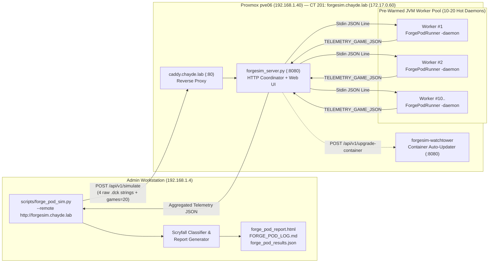

# MTG Forge 4-AI Commander Pod Simulation Cluster (`forgesim_cluster`)

> **Authoritative Architecture & Operations Manual**
> This folder contains the server coordinator, Java telemetry bridge, container definitions, and operational documentation for running headless 4-AI Commander pod simulations locally and across the **Chayde Homelab Cluster (`forgesim.chayde.lab`)**.

---

## 1. System Overview & Problem Solved

While [`scripts/multiplayer_goldfish.py`](../scripts/multiplayer_goldfish.py) is ideal for sub-second mana curve and opening hand math, it does not play out full interactive 4-player games with combat, blockers, board wipes, targeted removal, or opponent threat clocks.

The **Forge Pod Simulation Platform** wraps the open-source **MTG Forge v2.0.15** rules engine (`32,500+` implemented cards and AI controllers) in a custom Java telemetry bridge ([`scripts/ForgePodRunner.java`](../scripts/ForgePodRunner.java)) and Python orchestrator ([`scripts/forge_pod_sim.py`](../scripts/forge_pod_sim.py)).

### Why Offload to the Homelab Cluster (`forgesim.chayde.lab`)?
When running Forge from the command line, each Java process must cold-boot and parse `cardsfolder.zip` (**32,578 card scripts**), costing **10–12 seconds** and **~1.2 GB RAM** per worker before Turn 1 even begins.

By deploying `forgesim_server.py` inside an unprivileged LXC container (**`CT 201` on `pve06` — Dual Xeon E5-2697 v2, 24C/48T, 128 GB RAM**):
1. **Zero Cold-Start Delay (`0.0s`):** `forgesim_server.py` maintains a pool of **10 to 20 Pre-Warmed JVM Workers** (`ForgePodRunner -daemon`) that boot once and keep all 32,578 cards hot in RAM 24/7.
2. **Massive Parallel Execution:** A 10-game or 20-game batch is split into 1-game micro-tasks and dispatched across all warm workers simultaneously, finishing **10–20 full Commander games in ~25–35 seconds total** with **0% CPU/RAM load** on the workstation (`192.168.1.4`).
3. **100% Process Isolation & Auto-Healing:** Each game runs in its own isolated warm JVM process. If any game encounters an infinite trigger loop, the coordinator hard-kills only that worker after the timeout and immediately warms a replacement in the background.
4. **Stateless Deck Payloads:** Your workstation sends the raw `.dck` text of all 4 seats directly inside the HTTP `POST /api/v1/simulate` JSON body—no NFS mounts or Git deck syncing required on the server.

---

## 2. Architecture Diagram



---

## 3. Telemetry Captured Per Game

Because stock MTG Forge CLI (`sim`) intentionally suppresses `Library -> Hand` zone changes in `GameLogFormatter.java`, [`ForgePodRunner.java`](../scripts/ForgePodRunner.java) injects two custom hooks into the engine:

1. **`HeroLobbyPlayerAi` & `HeroControllerAi` (Seat 1 Hook):**
   - Intercepts `mulliganKeepHand()` to record every **rejected 7-card mulligan hand** before it is shuffled back into the library.
   - Intercepts `tuckCardsViaMulligan()` to record the exact cards placed on the bottom of the library during London Mulligans.
   - Optionally overrides Forge's default land-count mulligan check with our **Smart Synergy-Aware Mulligan** (rejecting Synergy Traps: $\ge 3$ lands, $0$ ramp, $0$ enablers, $\ge 3$ high-CMC payoffs).
2. **`PodTelemetryVisitor` (`IGameEventVisitor` Event Bus Subscriber):**
   - Records Seat 1's exact **final kept hand** on Turn 1.
   - Captures every card Seat 1 draws (`GameEventCardChangeZone` from `Library` to `Hand`) with exact Hero turn, global turn, and phase.
   - Captures all land drops (and whether they entered tapped/untapped), spell casts, Commander casts/recasts, and end-of-turn board snapshots (lands, ready mana sources, creatures, total power, life total, and cards stranded in hand).
   - Tracks all targeted interaction fired by Seat 1 vs. opponents and by opponents vs. Seat 1, plus combat/commander/non-combat damage and elimination turns.

---

## 4. Self-Update Architecture (`version.json` Manifest + Web UI + CLI + Watchtower)

> ⚠️ **MANDATORY VERSIONING RULE (NON-NEGOTIABLE):**
> `chayde/mtg-deck-collection` is the authoritative source of truth for the ForgeSim application (`forgesim_cluster/forgesim_server.py`, `scripts/ForgePodRunner.java`, and `forgesim_cluster/ForgePodRunner.java`).
> **Whenever ANY change is made to the ForgeSim application (`forgesim_cluster/forgesim_server.py`, `scripts/ForgePodRunner.java`, or `forgesim_cluster/ForgePodRunner.java`), you MUST:**
> 1. **Bump `"version"`, `"released"`, and `"changelog"` in [`forgesim_cluster/version.json`](version.json)** (and `SERVICE_VERSION` in `forgesim_server.py`).
> 2. **Keep `scripts/ForgePodRunner.java` and `forgesim_cluster/ForgePodRunner.java` synchronized.**
>
> Because `mtg-deck-collection` receives frequent commits for decks and skills, ForgeSim's update checker **does NOT check raw Git commit SHAs**. Instead, it compares its local `version.json` against `forgesim_cluster/version.json` on GitHub `master`. If you do not bump `forgesim_cluster/version.json`, the cluster will not know an application update is available!

### Method A: Web Control Panel Button (`http://forgesim.chayde.lab`)
Open `http://forgesim.chayde.lab` (or `http://172.17.0.60:8080`) in any browser:
1. Click **"🔍 Check for Updates"** — calls `GET /api/v1/check-update`, which fetches `forgesim_cluster/version.json` from `chayde/mtg-deck-collection@master` on GitHub and compares the semantic version against the running service's `version.json`.
2. Click **"⚡ Pull GitHub Update & Recompile"** — calls `POST /api/v1/update` (`{"mode": "github"}`), which downloads the latest `forgesim_cluster/version.json`, `scripts/ForgePodRunner.java`, and `forgesim_cluster/forgesim_server.py` from GitHub `master`, runs `javac` inside `/app/build` in `<2 seconds`, recycles all 10–20 warm JVM workers, and automatically restarts the Python coordinator if `forgesim_server.py` changed.
3. Click **"🐳 Watchtower Image Upgrade"** — calls `POST /api/v1/upgrade-container`, which triggers `forgesim-watchtower` (`http://watchtower:8080/v1/update` with `Bearer ${WATCHTOWER_HTTP_API_TOKEN}`) to pull the latest `ghcr.io/chayde/forgesim:latest` Docker image built by [`.github/workflows/forgesim-docker-publish.yml`](../.github/workflows/forgesim-docker-publish.yml) and recreate the container.

### Method B: Direct Workstation CLI Push (`--update-remote`)
When editing [`scripts/ForgePodRunner.java`](../scripts/ForgePodRunner.java) locally on your workstation (`192.168.1.4`), you can push and compile your local changes straight to `forgesim.chayde.lab` before even committing to GitHub:

```powershell
# Push local scripts/ForgePodRunner.java directly over LAN, recompile, and recycle warm JVMs:
python scripts/forge_pod_sim.py --update-remote push

# Or tell the cluster to pull latest from GitHub master:
python scripts/forge_pod_sim.py --update-remote github

# Or trigger Watchtower full container image upgrade:
python scripts/forge_pod_sim.py --update-remote watchtower

# Check if the remote cluster is behind GitHub master:
python scripts/forge_pod_sim.py --check-remote-update
```

---

## 5. Everyday CLI Usage (`scripts/forge_pod_sim.py`)

### Run on the Homelab Cluster (`forgesim.chayde.lab`)
```powershell
# Run 20 games on the homelab cluster (default URL: http://forgesim.chayde.lab)
python scripts/forge_pod_sim.py "commander_decks/Planning/ObekaSplitterOfSeconds" --remote --games 20 --bracket 3

# Specify a custom opponent gauntlet on the homelab cluster
python scripts/forge_pod_sim.py "commander_decks/Owned/UrDragon" --remote --pod "Karametra" "Sauron" "MerenReanimator" --games 10 --bracket 3
```
*(Tip: If you set the environment variable `FORGESIM_URL=http://forgesim.chayde.lab` on Windows, `forge_pod_sim.py` will automatically use the homelab cluster by default and transparently fall back to local execution if the homelab is unreachable! Use `--local` at any time to force local execution.)*

### Run Locally on Your Workstation
```powershell
python scripts/forge_pod_sim.py "commander_decks/Planning/ObekaSplitterOfSeconds" --local --games 4 --workers 2 --bracket 3
```

---

## 6. Homelab Deployment Specification (`CT 201` on `pve06`)

All deployment automation files have been staged into `C:\Antigravity\homelab-automation\forgesim\`:

| Setting | Value | Rationale |
|---|---|---|
| **Target Proxmox Node** | **`pve06`** (`192.168.1.40`) | Dual Xeon E5-2697 v2 (24C/48T) with ~114 GB free RAM — built for parallel multi-JVM workloads. |
| **Container Type & ID** | Unprivileged LXC **`CT 201`** | Bare-metal Linux scheduling with zero hypervisor overhead (`nesting=1,keyctl=1`). |
| **Hostname & FQDN** | `forgesim.chayde.lab` | Registered in `pihole01.chayde.lab` (`172.17.0.4`) and reverse-proxied by `caddy.chayde.lab` (`172.17.0.40`). |
| **Network & IP** | VLAN `252` (`vmbr0`), **`172.17.0.60/24`** | Gateway `172.17.0.1` (`pfsense.chayde.lab`), DNS `172.17.0.4`. |
| **vCPUs & Memory** | **20 vCPUs**, **24,576 MB (24 GB) RAM**, **4 GB Swap** | Easily hosts 10–16 warm JVMs (`1.5 GB` heap each) while leaving ~90 GB free on `pve06`. |
| **Root Disk** | **25 GB** on `local-lvm` | High-IOPS node-local SSD for fast container image extraction and `cardsfolder.zip` loading. |
| **Proxmox Tags** | `forgesim;docker;ubuntu` | Integrates with the weekly n8n automated patching workflow. |
| **Observability** | `:8080/health` + `:9100` (`node_exporter`) | Monitored by Uptime Kuma (`172.17.0.191:3001`) and Prometheus (`172.17.0.71:9090`). |
